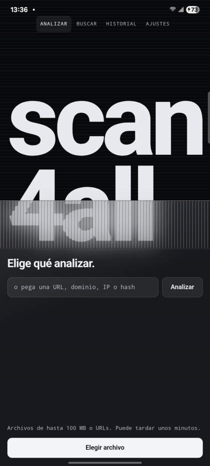
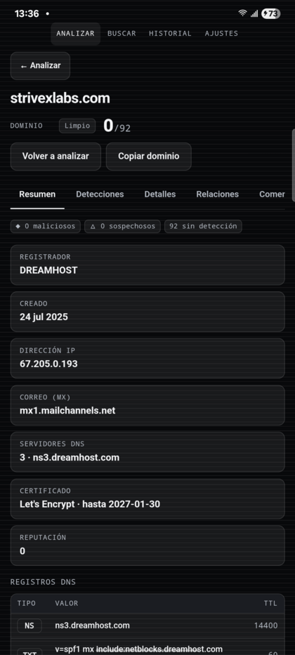
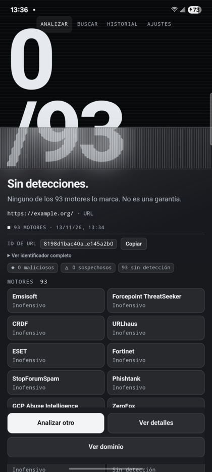
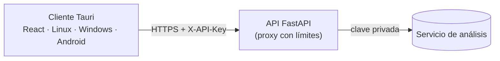

<div align="center">

# scan4all

**Analiza archivos, URLs, dominios, IPs y hashes contra decenas de motores de seguridad.**
Una sola base de código para Linux, Windows y Android.


<br />


&nbsp;

&nbsp;


</div>

---

## Qué hace

| | |
|---|---|
| **Analizar** | Sube un archivo (hasta 100 MB) o pega una URL y obtén el veredicto de todos los motores, con la firma de cada detección. |
| **Buscar** | Un hash (MD5, SHA-1, SHA-256), un dominio, una IP o una URL abren su informe al instante. Cualquier otro texto se busca. |
| **Informes completos** | Resumen, detecciones, detalles técnicos, relaciones, comentarios y comportamiento en sandbox (archivos). |
| **Dominios e IPs** | Registrador, fechas, direcciones, correo, DNS, certificado y reputación, en tarjetas legibles. |
| **Amenazas a la vista** | Si algo está infectado, un aviso naranja lo dice con los motores que lo marcan. La forma también cambia, no solo el color. |
| **Comunidad** | Lee y escribe comentarios y vota si un elemento es inofensivo o malicioso. |
| **Volver a analizar** | Pide un análisis nuevo de cualquier elemento desde su informe. |
| **Historial local** | Lo analizado y consultado se guarda solo en el dispositivo. |
| **Tema y servidor** | Claro, oscuro o automático; la dirección del servidor se cambia en Ajustes sin recompilar. |

## Plataformas

| Plataforma | Formato | Notas |
|---|---|---|
| **Linux** | `.deb`, AppImage | Compilados; en uso diario solo se ha corrido en modo desarrollo. |
| **Windows** | Instalador NSIS (x64) | Sin firma de código: SmartScreen avisa la primera vez. |
| **Android** | APK firmado (arm64 y armv7) | Android 7 o superior. La versión de producción exige HTTPS. |

## Arquitectura



- **Cliente** (`apps/app`): Tauri 2 + React 19 + Vite + TypeScript. El mismo frontend se empaqueta como app de escritorio y Android.
- **API** (`apps/api`): FastAPI. Guarda la clave del servicio de análisis (nunca llega al cliente), valida cada entrada, limita por IP y filtra qué rutas existen.
- **Monorepo** con pnpm workspaces.

```
apps/
  app/    Cliente Tauri (src/ = React, src-tauri/ = Rust, gen/android = proyecto Android)
  api/    API FastAPI, Dockerfile, deploy/ y tests/
docs/     Capturas del README
```

## Empezar

### Requisitos
- Node + pnpm, Rust (rustup) y Python 3.10+.
- **Linux:** `sudo apt install libwebkit2gtk-4.1-dev libgtk-3-dev libayatana-appindicator3-dev librsvg2-dev patchelf`
- **Android:** JDK 17+, Android SDK/NDK (`ANDROID_HOME`, `NDK_HOME`) y
  `rustup target add aarch64-linux-android armv7-linux-androideabi i686-linux-android x86_64-linux-android`

### Desarrollo
```bash
pnpm install
pnpm api         # API en :8008 (necesita apps/api/.env)
pnpm dev         # app de escritorio (tauri dev)
pnpm dev:web     # solo el frontend en el navegador (vite, :1420)
pnpm typecheck
```

Configuración local, en archivos `.env` que **no** se suben al repositorio:

| Archivo | Variable | Para qué |
|---|---|---|
| `apps/api/.env` | `VT_API_KEY`, `API_TOKEN` | Clave del servicio de análisis y token que el cliente envía en `X-API-Key` (mínimo 16 caracteres). |
| `apps/app/.env` | `VITE_API_URL`, `VITE_API_TOKEN` | Dirección de la API en desarrollo y el mismo token. |

`apps/app/.env.production` fija la dirección pública de la API para los instalables.

### Tests
```bash
pnpm --filter @scan4all/app test                                  # cliente
cd apps/api && pip install -r requirements-dev.txt && python -m pytest -q   # API
```

## Compilar

**Linux**
```bash
cd apps/app && pnpm tauri build --bundles deb,appimage
```

**Android** (el release se firma con una llave fuera del repo, en `~/.android/scan4all-signing.properties`)
```bash
pnpm android:init                                   # una sola vez
pnpm android:build --apk --target aarch64 --target armv7
```

**Windows** se puede compilar desde Linux con `cargo-xwin` y NSIS, sin tocar una PC Windows:
```bash
sudo apt install lld llvm nsis
rustup target add x86_64-pc-windows-msvc && cargo install cargo-xwin
cd apps/app
XWIN_ACCEPT_LICENSE=1 pnpm tauri build --runner cargo-xwin --target x86_64-pc-windows-msvc --bundles nsis
```

También hay un workflow de GitHub (`.github/workflows/build.yml`) que se dispara a mano o con un tag `v*`. No firma el APK, por lo que los instalables finales se construyen en local.

## API

Endpoints, variables de entorno, límites y despliegue en `apps/api/README.md`.

```bash
cd apps/api
python3 -m venv .venv && . .venv/bin/activate
pip install -r requirements.txt
uvicorn main:app --host 0.0.0.0 --port 8008
```

**Despliegue:** contenedor Docker (`apps/api/Dockerfile`) detrás de un túnel de Cloudflare. `apps/api/deploy/deploy.sh` lo sube y lo levanta; es idempotente.

## Seguridad

- El token del cliente (`API_TOKEN`) viaja dentro de los instalables, así que se puede extraer. Por eso la API limita por IP, valida todo y no expone más rutas de las necesarias.
- Comentarios y votos se publican con la cuenta de la clave del servidor. Con `ALLOW_WRITES=0` en la API quedan desactivados.
- Rotar el token implica recompilar los instalables.
